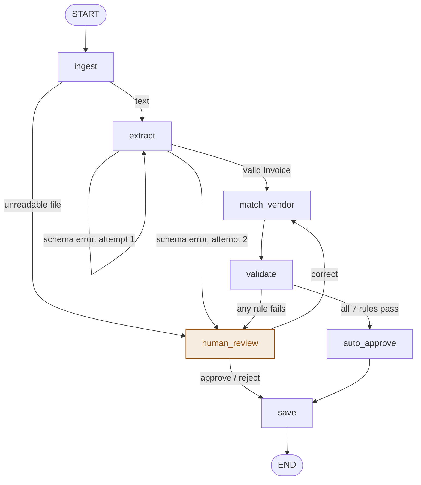

# invoice-agent

**Live demo: [invoice-agent-nityashree.vercel.app](https://invoice-agent-nityashree.vercel.app)** (demo mode: rule-based extractor, no API key) · by [Nityashree S](https://nityashree.in)

> A LangGraph agent that turns an invoice (PDF, image or text) into validated, structured data ready for accounts payable. **The model reads; tested code decides.** An LLM fills a strict Pydantic schema, a small vector store matches the vendor, seven plain-Python rules check the numbers, and anything that fails stops for a human via LangGraph's `interrupt()` before it is saved.


---

## What it does and why

Invoice intake is a common place to put an LLM, and a risky one: a model that misreads a total or invents a PO number can make someone pay the wrong amount. This project, inspired by finance-ops agent work, splits the job so each part does what it is good at:

| Step | Who does it | Why |
|---|---|---|
| Read the invoice into fields | the **model** (or a free demo extractor) | Layouts vary endlessly; reading them is what LLMs are good at |
| Check the output's shape | **Pydantic** (`Invoice` schema) | Malformed output is rejected and retried, never passed on |
| Work out who the vendor is | a **vector store** over the vendor master | Names are printed in many spellings |
| Decide if it is payable | **tested Python rules** | Arithmetic, dates and duplicates need exact, repeatable answers |
| Handle exceptions | a **human**, via `interrupt()` | A person approves, rejects or corrects; the run waits for them |

Input: one file. Output: a JSON invoice, the result of every rule, the vendor match with a score, the path the graph took, and a saved record with an audit log.

## The graph



| Node | What it does | Code |
|---|---|---|
| `ingest` | PDF text via pypdf (layout mode keeps table columns apart); plain text as is; images only if the optional OCR extra is installed. Scanned, damaged, password-protected and not-really-PDF files get a plain-language message and go to a human | [`ingest.py`](invoice_agent/ingest.py) |
| `extract` | Extractor output validated with `Invoice.model_validate`. On failure the exact error is fed back to the model and it retries once (the deterministic demo extractor is not retried); the reviewer sees the same failure in words ("could not find invoice date on the invoice") | [`graph.py`](invoice_agent/graph.py), [`extractors.py`](invoice_agent/extractors.py) |
| `match_vendor` | Embeds the printed vendor name and returns the closest vendor-master entry and its cosine score | [`vendors.py`](invoice_agent/vendors.py) |
| `validate` | Runs the seven rules; no short-circuit, so a reviewer sees every problem at once. If the extractor had to approximate something (for example it could not read the line-item table), that is added as a failed `extraction_is_complete` check, so a human confirms it | [`rules.py`](invoice_agent/rules.py) |
| `auto_approve` / `human_review` | Conditional edge on the rule results. `human_review` calls `interrupt()` with the reasons; `Command(resume=decision)` continues it | [`graph.py`](invoice_agent/graph.py) |
| `save` | Upserts the record into SQLite and writes the audit log; approved invoices join the duplicate ledger | [`store.py`](invoice_agent/store.py) |

**The seven rules** (all pure functions, table-tested in [`tests/test_rules.py`](tests/test_rules.py)):

1. `line_items_sum_to_subtotal`: each line's quantity x unit price equals its amount, and the lines add up to the subtotal
2. `subtotal_plus_tax_equals_total`: within 0.02 (money compared in `Decimal` cents, never floats)
3. `dates_are_sane`: not in the future, not over a year old, due date not before the invoice date, terms at most 120 days
4. `currency_is_iso4217`: the code is a real ISO 4217 currency
5. `vendor_is_known`: vendor match score at least 0.75
6. `not_a_duplicate`: the same vendor and invoice number are not already on file (paid invoices plus everything this system approved; case and spaces ignored)
7. `matches_purchase_order`: if a PO number is printed, the PO exists, belongs to this vendor, is in the same currency and covers the total

**Reliability built in:**

- **Durable runs.** A SQLite checkpointer (`SqliteSaver`) saves state after every node. A review can come days later, after a restart, and resumes where it paused. If a run crashes mid-way (say the LLM provider is down), submitting the same file again resumes it from the last checkpoint. Both cases are tested.
- **Idempotency.** Each upload is keyed by the SHA-256 of its bytes, so the same file twice returns the first run instead of processing (and paying) it again. A *different* file for the same invoice is caught by the duplicate rule instead.
- **Retry with feedback.** Output that fails the schema gets one more try with the exact validation error in the prompt. After that a human gets the partial output as a draft to fix.

## Design decisions

**Why LangGraph.** The flow is not a straight line. It has a retry loop, a branch, and a pause for a person that might last days. Plain function calls would need hand-written state saving and a way to resume. LangGraph gives each of these a name (nodes, conditional edges, `interrupt()`), and its checkpointer makes the pause durable. The graph is also small enough to read in one file and to draw (above), which helps when explaining it.

**Why "the model reads, code decides".** An LLM is good at reading messy layouts and bad at guaranteeing arithmetic or remembering what was paid last month. So the model only produces data, constrained by a Pydantic schema, and everything that decides whether money moves is ordinary Python with table-driven tests. Swapping the model (or a provider changing it underneath you) cannot change the approval logic, and every decision can be explained by pointing at a rule. The extractor is told to copy what is printed, not to fix it, so a wrong total on the invoice shows up as a failed rule instead of being silently corrected.

**Why a vector match for vendors.** Vendor names are printed inconsistently: "NORTHWIND OFFICE SUPPLY CO." for "Northwind Office Supplies Pvt Ltd". Exact lookup misses these. Asking an LLM "is this the same company?" is slow, costs money and is not repeatable. Embedding the names and taking the nearest neighbour gives a score that can be thresholded and tested. The embedder here hashes character 3-grams into a 1,024-dimension vector: no model download, no key, deterministic, about a millisecond. It measures spelling similarity, not meaning, which is what vendor names need. The store sits behind a two-method `VectorStore` interface (`add`, `query`), so Chroma, pgvector or FAISS can replace the in-memory NumPy store without touching the graph.

**Why a demo extractor.** Tests, CI, the eval and the public demo all run without an API key. The demo extractor is layout rules and regular expressions; it is a stand-in for the model, not a general invoice reader. It never guesses: a field it cannot find is left empty and the invoice goes to a human with the reason. The real model plugs in through LangChain's `ChatOpenAI(...).with_structured_output(Invoice, method="json_schema", include_raw=True)` against any OpenAI-compatible API, with the same schema.

## Run it

Python 3.11 or newer.

```bash
git clone https://github.com/Nityaa08/invoice-agent.git
cd invoice-agent
python -m venv .venv && source .venv/bin/activate
pip install -r requirements-dev.txt

uvicorn main:app --reload        # http://127.0.0.1:8000 (page) and /docs (API)
```

That runs the full service with the demo extractor, storing data in `./var/` (SQLite). Settings are environment variables; see [`.env.example`](.env.example). To load a `.env` file into your shell: `set -a; . ./.env; set +a`.

**With a real model** (Groq's free tier works; any OpenAI-compatible API does):

```bash
export EXTRACTOR=llm
export LLM_API_KEY=your_key            # from console.groq.com; never commit it
export LLM_MODEL=openai/gpt-oss-20b    # default
export LLM_BASE_URL=https://api.groq.com/openai/v1   # default; e.g. https://api.openai.com/v1
# export LLM_STRUCTURED_METHOD=function_calling      # if your provider lacks JSON-schema mode
uvicorn main:app --reload
```

**The API:**

```bash
# upload (or: -F sample=04_saffron_wrong_total.pdf)
curl -F file=@samples/04_saffron_wrong_total.pdf http://127.0.0.1:8000/invoices
# -> 201 {"id": "...", "status": "needs_review", "review_request": {"reasons": [...]}, ...}

curl http://127.0.0.1:8000/invoices/<id>

# approve, reject, or correct (send the fixed invoice); this resumes the paused graph
curl -X POST http://127.0.0.1:8000/invoices/<id>/review \
     -H 'Content-Type: application/json' \
     -d '{"action": "approve", "reviewer": "asha", "note": "confirmed with vendor"}'
```

| Endpoint | Purpose |
|---|---|
| `POST /invoices` | Multipart `file` or form field `sample`. 201 for a new run, 200 with the original run if the same file was sent before |
| `GET /invoices/{id}` | Status, extracted invoice, vendor match, rule results, graph path, pending review, audit log |
| `POST /invoices/{id}/review` | `{"action": "approve" \| "reject" \| "correct", "invoice": {...}, "reviewer", "note"}`. 409 if the run is not waiting, 422 for bad input |
| `POST /api/demo/run` | Demo mode only: one stateless run; see below |
| `GET /api/samples`, `/api/config`, `/api/health` | For the page |

## What the demo extractor reads

Uploads to the public demo use the demo extractor, so it has to cope with invoices that look nothing like the samples. It reads PDFs that have a text layer (exported from accounting software, a browser, Word or a PDF printer) and:

| | Handled |
|---|---|
| Layouts | label and value side by side, in two columns, or the label above its value (Tally-style boxes); bordered and borderless tables; totals blocks on the right; multi-page invoices (line items on every page, totals on the last; the first 9 pages and the last one are read) |
| Labels | Invoice No. / Invoice # / Inv # / Invoice Ref / Bill No / Invoice:; Invoice Date / Dated / Date of issue / Tax Point; Due Date / Payment due; PO / P.O. # / Buyer's Order No. / Your Order; Sub Total / Taxable Value / Total excl. VAT / Net Total; CGST / SGST / IGST / VAT / Sales Tax / HST; Grand Total / Invoice Total / Total; Amount Due / Balance Due / Amount Owing |
| Numbers | `1,234.56`, `1.234,56` (decided once per document), Indian lakh grouping `1,23,456.00`; `₹`, `Rs.`, `INR`, `$`, `US$`, `CA$`, `€`, `£` |
| Dates | `2026-11-14`, `14-Nov-2026`, `14 Nov 2026`, `2nd November, 2026`, `November 2, 2026`, `14.11.2026`, `14/11/2026`, `11/14/2026` (month first on US-dollar invoices, unless a part over 12 says otherwise), two-digit years |
| Tax ids | GSTIN (the seller's, the first one printed), EU VAT numbers including spaced ones, US EIN, Canadian GST/HST numbers |

What happens when it cannot read something:

- **A field is missing** (no invoice number, no date, no total): the invoice goes to review with "could not find invoice date on the invoice"; the page shows what it did read, and "Correct fields" pre-fills it.
- **Line items cannot be read as a table** (a prose invoice, an unusual layout): one "Invoice total (line items not itemised)" line carries the subtotal, and the failed `extraction_is_complete` check sends it to review.
- **A scanned PDF** (no text layer, or only a scanner watermark): "This PDF is a scanned image. The demo reads PDFs with a text layer; OCR is listed as a next step." Nothing is extracted.
- **Not a PDF, damaged, password-protected, empty, or over 4 MB**: a plain message; the page checks the size and type before uploading.

A real model (`EXTRACTOR=llm`) reads uploads through the same path and does not have these layout limits.

## Tests

```bash
python -m pytest
```

186 tests, no network or API key needed, about 3 seconds. They passed on 2026-11-16.

| File | What it covers |
|---|---|
| `test_rules.py` (42) | Every rule, table-driven: tolerances, float-safe money, date edge cases, duplicate normalization, PO vendor/currency/amount; schema rejects malformed output |
| `test_graph.py` (16) | Every path: happy path; interrupt then approve, reject, correct; a correction that still fails pauses again; retry with the error fed back; giving up after two attempts, with the missing fields in words; unreadable files; duplicates; idempotent resubmission; **resume a review after a restart** (SQLite checkpointer); **resume a crashed run** |
| `test_api.py` (16) | Upload, get, review, idempotent 200, 404/409/413/422, the stateless demo with replayed decisions, rate limit, Vercel defaults, and that `main.py` has a top-level `app = FastAPI(...)` |
| `test_vendors.py` (15) | Embedder determinism, store contract, name variants matched, unknown names below threshold |
| `test_extract_ingest.py` (29) | Amount and date parsing (1,234.56 and 1.234,56), PDF text, demo extractor, ingest errors |
| `test_llm_extractor.py` (5) | The real LangChain `ChatOpenAI` path with the HTTP call faked: the schema is sent as `response_format`, answers are parsed, schema errors and HTTP errors are handled, feedback reaches the model |
| `test_real_world_pdfs.py` (55) | Uploads through `/api/demo/run` with Vercel's settings: an Indian GST tax invoice (CGST + SGST, lakh grouping, labels above values), an IGST bill, a US, an EU and a three-page invoice, a prose invoice (total-only fallback), a scanned PDF (the clear message), truncated / not-a-PDF / Word / unknown files, an oversize and an empty upload; label synonyms, number and date formats; upload dates checked against today; `EXTRACTOR=llm` reading an upload; a missing key falling back to the demo |
| `test_store.py` (4), `test_eval.py` (4) | Store idempotency and ledger; the eval on all three sets runs in CI |

CI runs the suite on Python 3.11, 3.12 and 3.13 ([`.github/workflows/ci.yml`](.github/workflows/ci.yml)).

## Eval

```bash
python evals/run_eval.py --markdown                 # the ten samples
python evals/run_eval.py --set realworld --markdown # real-world-style PDFs
python evals/run_eval.py --set blind --markdown     # three PDFs written after the extractor was frozen
# with a real model:
EXTRACTOR=llm LLM_API_KEY=... python evals/run_eval.py --markdown
```

[`evals/run_eval.py`](evals/run_eval.py) runs each sample through the full graph and compares the result with the hand labels in [`samples/manifest.json`](samples/manifest.json): 11 fields per invoice (vendor, tax id, number, dates, currency, PO, line count, subtotal, tax, total) and the decision (auto-approve or review, and exactly which rules failed).

Demo extractor, 2026-11-13:

| Metric | Result |
|---|---|
| Field accuracy (11 fields x 9 invoices) | 100% |
| Decision accuracy (auto-approve vs review) | 100% (10 of 10) |
| Exactly the expected rules failed | 100% (10 of 10) |
| Sent to review | 6 of 10 (all six broken on purpose) |
| Mean time per invoice | about 20 ms |

**Read these numbers honestly.** The demo extractor was written against these same ten invoices, so 100% field accuracy shows the pipeline is wired correctly, not that it reads invoices well. The decision numbers mean more: given the extracted fields, the rules and the graph send every invoice down the right path. The missing-number invoice is excluded from field accuracy (there is no invoice to score) and counted in decision accuracy.

**Real-world-style PDFs** ([`tests/fixtures/pdfs/`](tests/fixtures/pdfs/), made by [`scripts/make_test_pdfs.py`](scripts/make_test_pdfs.py), labels in `labels.json`). On 2026-11-16 the original demo extractor read **none** of the six text-layer invoices: every one stopped with the schema error and no invoice. After the fixes it reads all six (100% of 66 fields) and sends the scan to review with the scan message; all seven go to review, correctly, because none of the made-up vendors is in the vendor master. These PDFs were written while fixing the extractor, so they are a regression set, not a measure of accuracy on unseen invoices.

**Blind set** (`blind_labels.json`). Three more PDFs (a UK, a Canadian and a GST invoice with an HSN tax summary) were written after the extractor was frozen and run once, unchanged: 1 of 3 read fully (with the wrong vendor name, 10 of 11 fields); the other two went to review because the invoice number or date was not found. Nothing was approved wrongly. The misses were then fixed, so this set is now a regression set too (100%). That first run is the honest number for unseen layouts: the demo extractor fails safe, but it misses often. A real model and a larger, truly held-out set of real invoices are the next step.

## The samples

Ten synthetic invoices in [`samples/`](samples/), made by [`scripts/make_samples.py`](scripts/make_samples.py). Every company, tax id and number is made up.

| File | Case | Expected |
|---|---|---|
| `01_northwind_ok.pdf` | GST invoice with a matching PO | auto-approve |
| `02_bluepeak_ok.txt` | US invoice, `$` amounts, month-name dates, no PO | auto-approve |
| `03_kestrel_ok.pdf` | German invoice, `1.234,56` amounts, `dd.mm.yyyy` dates, VAT id | auto-approve |
| `04_saffron_wrong_total.pdf` | total is 1,000 too high | review |
| `05_bluepeak_duplicate.txt` | already paid | review |
| `06_unknown_vendor.txt` | vendor not in the vendor master | review |
| `07_missing_invoice_number.txt` | no invoice number: schema fails twice | review, with a draft to fix |
| `08_northwind_name_variant.pdf` | vendor printed as "NORTHWIND OFFICE SUPPLY CO." | auto-approve (vector match 0.85) |
| `09_saffron_po_exceeded.txt` | total above the PO amount | review |
| `10_tidewater_bad_dates.txt` | due date before invoice date | review |

Reference data: [`data/vendors.json`](data/vendors.json) (8 vendors), [`data/purchase_orders.json`](data/purchase_orders.json), [`data/paid_invoices.json`](data/paid_invoices.json).

## Deploy to Vercel (free tier)

The public demo runs in **demo mode**, because Vercel's Python functions keep no files between requests, so SQLite (and the SQLite checkpointer) would not persist. In demo mode:

- `POST /api/demo/run` does a whole run in memory inside one request (an `InMemorySaver` checkpointer and an in-memory store, fresh each time; visitors never see each other's data).
- Human review stays within the page session: the page keeps the file and sends it again with every decision so far, and the server replays the run and resumes the interrupt with each decision. The demo extractor is deterministic, so the replay reaches the same pause.
- The samples' dates are checked as of 2026-11-13 so they do not go stale; uploaded invoices are checked against today (unless `AS_OF_DATE` is set), so a real invoice dated this week is not "in the future".
- 60 runs per hour per visitor (per instance), 4 MB uploads (Vercel caps a function's request body at 4.5 MB; the page checks the size before sending).
- Each demo run logs one INFO line (upload or sample, size, file extension) and, if it goes to review, why; no file names or contents. These show in Vercel's runtime logs.
- `main.py` defines `app = FastAPI(...)` at the top level, which is what Vercel's FastAPI preset looks for. A test checks this.
- Installed dependencies are about 140 MB, under the 500 MB function limit; `vercel.json` keeps tests, evals and scripts out of the bundle.

Steps (only after the GitHub repo exists):

1. Go to [vercel.com/new](https://vercel.com/new) and import `Nityaa08/invoice-agent`.
2. Framework preset: **FastAPI** (Vercel detects it from `main.py`). Leave build and output settings empty. Root directory: the repo root.
3. Environment variables: none are required. Vercel sets `VERCEL=1`, which turns demo mode on. Optional: `EXTRACTOR=llm`, `LLM_API_KEY` (encrypted in Vercel; never in the repo) and `LLM_MODEL` to use a real model; the page then says "Live model".
4. Deploy. Check `https://<project>.vercel.app/api/health` returns `{"status": "ok"}`, open the page and run "Wrong total" through to approval.
5. Optional: under Settings → Domains rename the project domain (for example `invoice-agent-nityashree.vercel.app`), then put the link at the top of this README.

For the full service with persistence, run `uvicorn main:app` on any VM or container with a disk, or swap SQLite for Postgres (`langgraph-checkpoint-postgres` plus a Postgres `InvoiceStore`).

## Limits

- **The demo extractor reads common text-layer layouts, not every invoice.** On a first, blind run it fully read 1 of 3 unseen layouts (see Eval); what it cannot read goes to a human with the reason, it does not guess. Real invoices at volume need `EXTRACTOR=llm`. The real-model path, including uploads, is tested with a faked HTTP response, not yet evaluated against a live model.
- **The eval sets are small and not truly held out** (see above). They show each path works; they do not measure extraction quality on real invoices.
- **No OCR in the demo.** Scanned PDFs and photos have no text layer; the demo says so and sends them to a human. Locally, images can be read with the optional `pytesseract` + Tesseract; scanned PDFs need OCR (for example rendering pages and running Tesseract, or a vision model), which is the next step.
- **Uploads are limited to 4 MB and the first 9 pages plus the last.**
- **The vendor embedder compares spelling, not meaning.** "Blue Peak Cloud" scores 0.63 against "Bluepeak Cloud Services Inc" and goes to review. That fails safe, but it means more reviews; a learned embedder or a tax-id check would catch more.
- **Money uses floats in the schema** (what LLM JSON gives you) and `Decimal` cents in every comparison.
- **No authentication** on the full service, and the demo rate limit is per instance. Fine for a demo; a real deployment needs auth and a shared limiter.
- **Single currency per invoice**, no partial payments, no credit notes or discounts; line items whose quantity x price does not match the printed amount (discount columns) are not read as items.

## Project layout

```
main.py                     FastAPI app (Vercel entry point)
invoice_agent/
  schema.py                 Pydantic Invoice / LineItem: the extraction contract
  extractors.py             DemoExtractor (rules + regex), LLMExtractor (LangChain structured output)
  ingest.py                 file -> text (pypdf, optional OCR), size and type checks
  vendors.py                HashingEmbedder, NumpyVectorStore, VendorMatcher
  rules.py                  the seven validation rules (pure functions)
  graph.py                  the LangGraph StateGraph, interrupt() for review
  store.py                  SQLite: runs (idempotency), invoices, duplicate ledger, audit log
  service.py                submit / get / review; SQLite or in-memory checkpointer
  api.py                    HTTP routes, demo mode, rate limit
  config.py                 settings from environment variables
  web/index.html            the one-page demo UI
data/                       vendor master, purchase orders, paid invoices (all fictional)
samples/                    10 synthetic invoices + manifest.json (hand labels)
evals/run_eval.py           field and decision accuracy (samples, real-world-style, blind sets)
scripts/make_samples.py     regenerates the sample invoices
scripts/make_test_pdfs.py   regenerates the real-world-style test PDFs (reportlab + Playwright)
tests/                      186 pytest tests; tests/fixtures/pdfs/ holds the test PDFs and their labels
```

## Licence

MIT. Built by [Nityashree S](https://nityashree.in), directing AI coding agents; design, review and testing decisions are mine.
